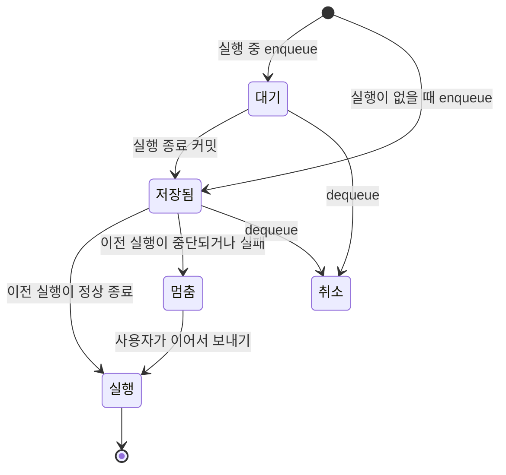
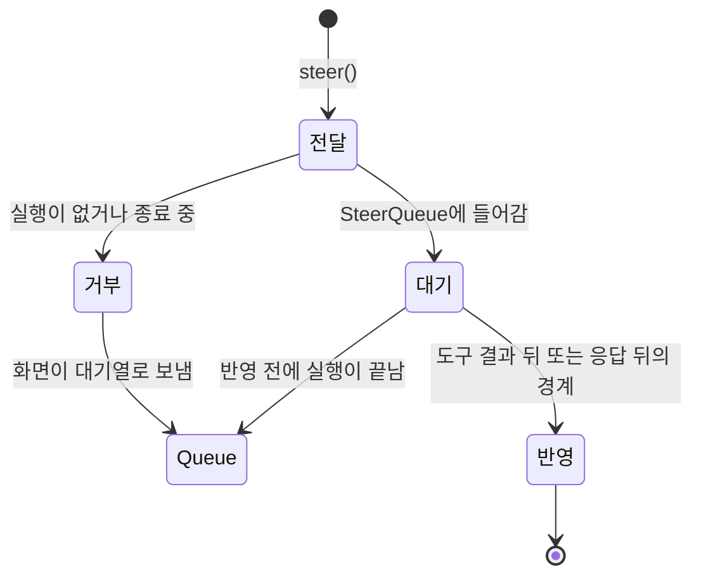

# 실행 제어: Queue, Steer, 재구독

실행 중인 대화에 메시지를 보내는 방법은 Queue와 Steer 두 가지입니다. 실행 이벤트는 generation journal의 `sequence`로 다시 구독합니다. 이 문서는 세 기능의 계약, 상태 전이, 보장 범위를 설명합니다.

## 계약

| 계약                                                     | 위치                  | 역할                                                                                     |
| -------------------------------------------------------- | --------------------- | ---------------------------------------------------------------------------------------- |
| `SteerQueue`                                             | `@keundal/core`       | 실행 중 지시를 순서대로 보관합니다. 에이전트는 안전한 경계에서만 지시를 꺼냅니다.        |
| `ExecutionOptions.steer`                                 | `@keundal/core`       | `agent.run()`에 지시 대기열을 전달합니다.                                                |
| `STEER_MESSAGE_EVENT`                                    | `@keundal/core`       | 반영한 지시를 journal에 남기는 AG-UI `CUSTOM` 이벤트 이름 `keundal.steer.message`입니다. |
| `GenerationService.subscribe()`                          | `@keundal/generation` | `afterSequence` 다음의 journal을 재생하고 실시간 기록을 이어서 전달합니다.               |
| `AgentHostServices.steer`, `cancel`, `subscribe`         | `@keundal/agent-host` | 호스트가 실행별 지시 대기열과 취소 신호를 관리합니다.                                    |
| `ChatStoreLike.enqueue`, `dequeue`, `steer`, `execution` | `@keundal/chat`       | 화면이 Queue와 Steer를 고르고 대기열을 관리합니다.                                       |

표준 AG-UI 이벤트는 바꾸지 않습니다. 지시는 `CUSTOM` 이벤트로만 기록합니다.

## 동시성 규칙

- 대화 하나에는 실행을 하나만 둡니다. 호스트는 같은 `threadId`의 두 번째 실행을 `409`로 거부합니다. 로컬 채팅 저장소는 같은 대화의 두 번째 `respond()`를 거부합니다.
- 다른 대화의 실행과 대기열은 서로 기다리지 않습니다.
- 실행 중에는 세션 revision을 바꾸지 않습니다. 실행 중에 받은 대기 메시지와 지시는 메모리에 모았다가 종료 커밋에서 한 번에 확정합니다.
- 대기열에서 꺼낸 메시지는 대화에 넣는 같은 커밋에서 대기열에서 지웁니다. 이 규칙으로 복구한 뒤에도 같은 메시지를 두 번 실행하지 않습니다.
- 대기열은 대화마다 32개로 제한합니다. 같은 id의 메시지는 한 번만 넣습니다.

## Queue 상태 전이

`useKeundalChat`은 `RUN_FINISHED`의 `outcome`이 없거나 `success`일 때만 다음 대기 메시지를 보냅니다. `cancelled`·`interrupt`, 오류 또는 종료 이벤트 없이 끊긴 실행은 대기열을 남겨 두고 멈춥니다. 복구 과정은 대기열을 자동으로 실행하지 않습니다. `interrupt`의 응답 입력과 새 실행 재개 UI는 아직 제공하지 않습니다.

## Steer 상태 전이

- 에이전트는 진행 중인 모델 요청과 이미 시작한 도구를 중단하지 않습니다.
- 도구 결과를 기록한 뒤와 도구 호출이 없는 응답 뒤에 지시를 꺼냅니다. 지시는 다음 모델 요청의 정상적인 사용자 메시지가 됩니다.
- 다음 요청에는 도구 후속 요청과 같은 입력 예산 검사와 축약 정책을 적용합니다.
- 이미 대화에 있는 id의 지시는 다시 넣지 않습니다. 지시가 2개 이상이면 보낸 순서대로 반영합니다.
- `maxToolRounds`에 도달했거나 도구를 등록하지 않은 실행은 지시를 꺼내지 않습니다. 반영되지 않은 지시는 보낸 순서대로 대기열 앞에 남습니다.
- 반영된 지시는 화면에 `metadata.steeredRunId`가 있는 사용자 메시지로 표시합니다. 모델 입력은 어시스턴트 기록에 들어 있는 원래 위치의 지시만 사용합니다.

## 재구독

`GET /runs/:runId/events?afterSequence=N`은 `N` 다음의 journal을 SSE로 전달합니다. 실행이 진행 중이면 새로 기록되는 이벤트를 이어서 전달하고, 종료된 실행은 마지막 기록 뒤에 끝납니다. `POST /runs`의 SSE도 같은 경로로 journal을 전달합니다.

- 저장소는 구독 리스너를 먼저 등록한 뒤 journal을 읽습니다. 이미 전달한 `sequence`는 다시 보내지 않으므로 저장된 기록의 재생과 새 기록의 전달 사이에 누락과 중복이 없습니다.
- SSE 프레임의 `id`는 journal `sequence`입니다. 클라이언트는 마지막으로 적용한 `id`를 커서로 쓰고, 그 이하의 `id`는 적용하지 않습니다.
- 실행이 성공하지 못하고 끝나면 호스트는 journal에 없는 `RUN_ERROR`를 `id` 없이 마지막에 한 번 보냅니다.
- 재구독은 실행을 다시 시작하지 않습니다. LLM과 도구를 다시 호출하지 않습니다.

## 연결 종료와 취소

| 사건                       | 호스트의 동작                                                   |
| -------------------------- | --------------------------------------------------------------- |
| 스트림을 연 뒤 연결이 끊김 | 구독만 끝냅니다. 실행은 계속되고 재구독할 수 있습니다.          |
| 첫 이벤트 전에 연결이 끊김 | 클라이언트가 실행 시작을 확인하지 못했으므로 실행을 취소합니다. |
| `POST /runs/:runId/cancel` | 실행을 취소하고 `cancelled`로 확정합니다.                       |
| `POST /runs/:runId/steer`  | 실행 중이면 `202`, 아니면 `409`를 돌려줍니다.                   |

`RemoteChatStore`는 네트워크 오류가 나면 연결 요청을 포함해 같은 실행을 최대 3번 다시 구독합니다. 재연결을 모두 실패해도 `pendingRunId`를 지우거나 부분 응답으로 세션을 덮어쓰지 않습니다. 다음 응답 요청은 같은 실행의 journal을 처음부터 재생하며 LLM과 도구를 다시 실행하지 않습니다. 같은 클라이언트에서 받은 대기 메시지도 유지하지만, 브라우저를 닫으면 아직 저장하지 못한 대기 메시지는 사라집니다.

사용자가 중단하면 최대 5초 동안 취소 접수를 확인합니다. 취소가 접수되면 최대 5초 동안 나머지 journal을 읽고, `RUN_FINISHED` 또는 `RUN_ERROR`를 확인한 경우에만 화면 결과를 확정합니다. 취소 요청이 실패하거나 종료 확인 시간이 지나면 `pendingRunId`를 유지하여 나중에 재구독하거나 복구할 수 있게 합니다.

## 메시지 조립

`@keundal/core`의 `EventNormalizer`는 `TEXT_MESSAGE_CHUNK`, `REASONING_MESSAGE_CHUNK`, `TOOL_CALL_CHUNK`를 시작·내용·종료 이벤트로 변환합니다. 첫 조각에는 ID가 필요하며 도구 호출은 이름도 필요합니다. 뒤의 조각은 ID를 생략할 수 있습니다. 종류나 ID가 바뀌거나 실행이 끝나면 열린 조각을 닫으며, 서브에이전트별 스트림은 서로 닫지 않습니다. 네트워크 연결이 끊겼다는 이유만으로 메시지를 닫지는 않습니다.

도구 실행과 세 저장소는 생산자 스트림의 정상 종료도 조각의 끝으로 처리합니다. 화면 조립과 journal 재생은 같은 정규화 규칙을 사용합니다. 텍스트의 `role`·`name`을 보존하고, 메시지와 도구 호출의 `metadata`는 각 이벤트의 값을 얕게 병합합니다. 화면은 어시스턴트가 아닌 텍스트의 역할을 표시하며 어시스턴트 응답과 합치지 않습니다.

## 실행 위치별 보장 범위

| 실행 위치                                               | 연결이 끊겼을 때                      | 프로세스가 끝났을 때                                                                                                                              |
| ------------------------------------------------------- | ------------------------------------- | ------------------------------------------------------------------------------------------------------------------------------------------------- |
| 브라우저 직접 실행(`ChatStore`, `execution: 'browser'`) | 연결 개념이 없습니다.                 | 탭을 닫으면 실행이 끝납니다. 다음 실행 때 `recover()`가 미완료 실행을 `interrupted`로 확정합니다. 실행 중에 받은 대기 메시지는 저장되지 않습니다. |
| Node.js 호스트(`execution: 'host'`)                     | 실행이 계속되고 재구독할 수 있습니다. | `recover()`가 미완료 실행을 `interrupted`로 확정합니다.                                                                                           |
| Tauri sidecar(`execution: 'host'`)                      | Node.js 호스트와 같습니다.            | sidecar를 다시 시작하면 실행이 끝납니다. 재구독은 `interrupted` 상태와 저장된 journal만 받습니다.                                                 |

화면은 `execution`이 `browser`일 때 탭을 닫으면 응답과 저장하지 않은 대기 메시지가 사라진다고 표시합니다. 살아 있는 실행의 재구독과 프로세스가 끝난 실행의 복구는 다른 기능입니다. `recover()`는 기존 정책대로 미완료 실행을 `interrupted`로 확정하고 LLM을 다시 호출하지 않습니다.

## 제한

- 실행 중에 받은 대기 메시지는 종료 커밋 전까지 메모리에만 있습니다. 그 사이에 프로세스가 끝나면 이 메시지는 사라집니다.
- 지시 대기열은 호스트 프로세스의 메모리에 있습니다. 반영되기 전에 호스트가 끝나면 지시를 잃습니다.
- 외부 시스템에 부작용을 남긴 도구를 정확히 한 번만 실행한다고 보장하지 않습니다. 재구독과 복구는 도구를 다시 실행하지 않습니다.
